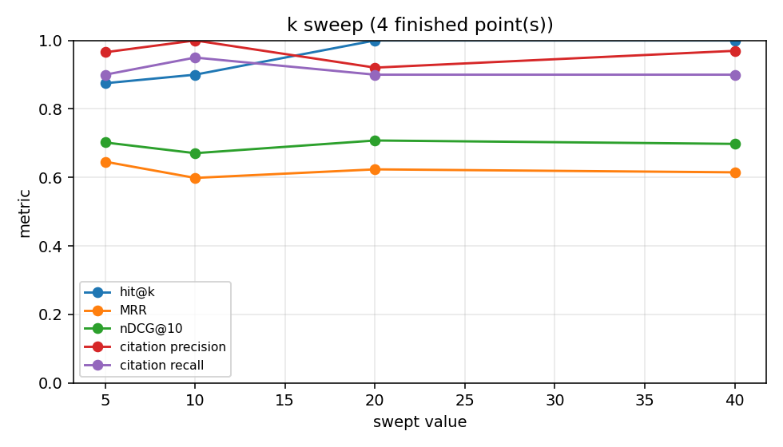
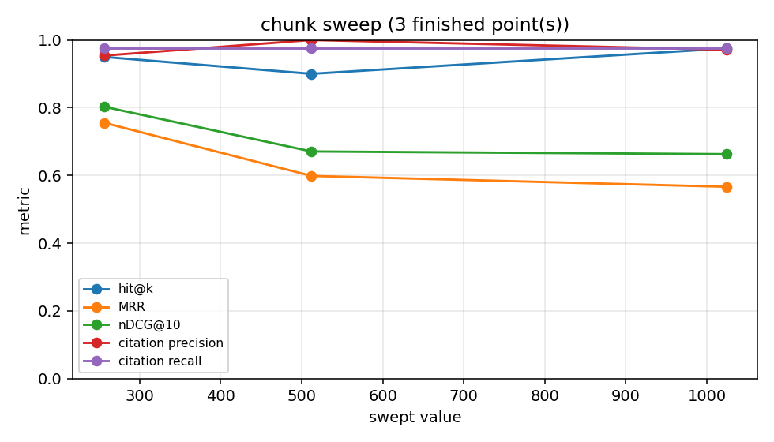
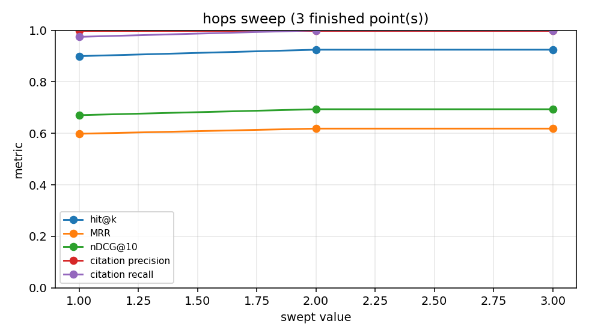
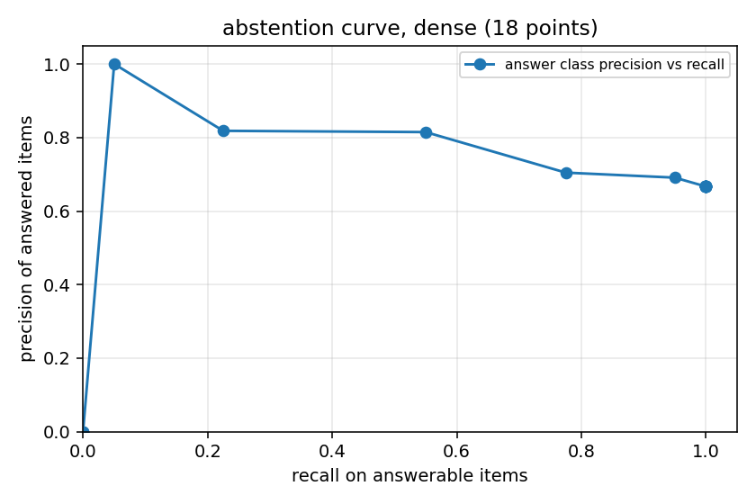
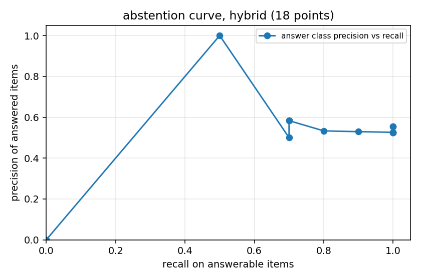
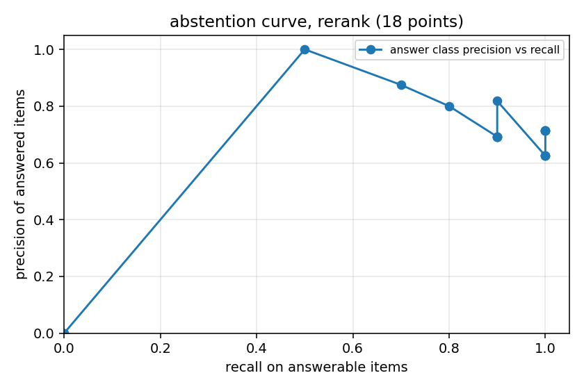

# Figures

Every figure here is redrawn from a CSV under `reports`, so the picture and the table beside it cannot disagree. The CSVs are written by the sweep and abstention commands; this step only draws.

## `figures/sweep-k.png`

Drawn from `sweeps/k.csv`: 4 of 4 point(s) finished.

## `figures/sweep-chunk.png`

Drawn from `sweeps/chunk.csv`: 3 of 3 point(s) finished.

## `figures/sweep-hops.png`

Drawn from `sweeps/hops.csv`: 3 of 3 point(s) finished.

## `figures/abstention-dense.png`

Drawn from `abstention/dense-pr.csv`: 18 of 18 point(s) finished.

## `figures/abstention-hybrid.png`

Drawn from `abstention/hybrid-pr.csv`: 18 of 18 point(s) finished.

## `figures/abstention-rerank.png`

Drawn from `abstention/rerank-pr.csv`: 18 of 18 point(s) finished.

